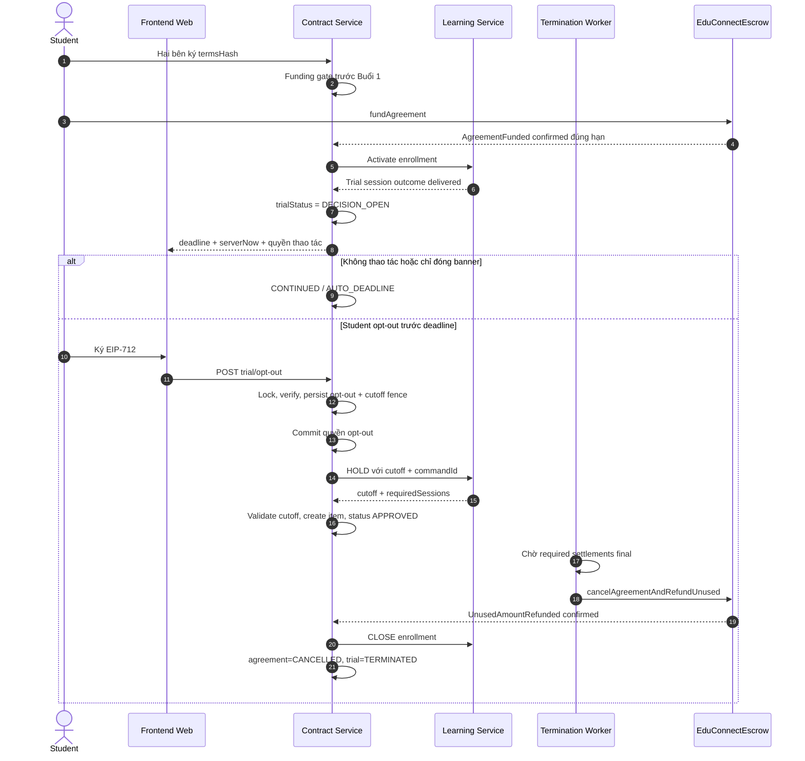

# KẾ HOẠCH TRIỂN KHAI GIAI ĐOẠN TRẢI NGHIỆM CÓ BẢO CHỨNG ESCROW

> Trạng thái: **MERGED + DEPLOYED — feature vẫn OFF (`ESCROW_TRIAL_ENABLED=false`)**
> Phạm vi: Learning Service, Contract Service, Notification Service, Frontend Web và tài liệu hợp đồng.
> Smart Contract Escrow V1 hiện tại được tái sử dụng; không thay đổi Solidity nếu audit triển khai không phát hiện yêu cầu mới.
> Rollout: mặc định `ESCROW_TRIAL_ENABLED=false`; tuyệt đối không tự bật tính năng chỉ vì migration đã chạy.

## 0. Nhật ký triển khai và bàn giao cho AI tiếp theo

> Cập nhật gần nhất: **2026-10-27**. Trạng thái phản ánh source **đã merge vào `main`** và **đã deploy VPS production** tại commit `986bc3c`. Migration V16/V21 đã chạy thành công trên production PostgreSQL. Feature vẫn OFF. Mọi kết quả `TESTED` bên dưới được ghi rõ môi trường (local/CI/Anvil/production).

| Task | Trạng thái | Bằng chứng hiện tại |
|---|---|---|
| `OPS-02` | `IMPLEMENTED + TARGETED TESTED` | `ESCROW_TRIAL_ENABLED=false` mặc định ở Learning/Contract, `compose.vps.yaml` và được ghi tường minh trong `deploy/production.env.example`; kill switch chỉ chặn tạo trial mới, không ngắt deadline/recovery worker của row đã được chấp nhận. |
| `LEARN-00` | `IMPLEMENTED + TESTED` | `CanonicalSessionPlanner` là nguồn sinh lịch dùng chung; `RollingSessionService` đã tái sử dụng planner và không còn làm mất ca thứ hai cùng ngày. 5 unit tests độc lập pass. |
| `LEARN-01` | `IMPLEMENTED + TESTED` | Đã có V16 additive, `trial_policy_version` trên `class_rooms`, entity/DTO mở rộng command audit/idempotency trên `learning_termination_stop`. |
| `LEARN-02` | `IMPLEMENTED + TESTED` | Platform tự gán `trialPolicyVersion = 1` cho lớp mới có `totalSessions >= 2` khi feature flag bật. |
| `LEARN-03` | `IMPLEMENTED + TESTED` | Planner tính session 1/2, offset `Asia/Ho_Chi_Minh`, deadline bằng thời điểm bắt đầu session 2 và SHA-256 canonical schedule fingerprint. |
| `LEARN-04` | `IMPLEMENTED + TESTED` | Internal Learning snapshot controller trả về snapshot trial policy và schedule fingerprint SHA-256 canonical khi flag ON. |
| `LEARN-05` | `IMPLEMENTED + TESTED` | Mở rộng internal termination command với `requestedCutoffSession`, `origin`, `effectiveRequestedAt`, `commandId`. |
| `LEARN-06` | `IMPLEMENTED + TESTED` | `LearningTerminationService` persist stop idempotent theo agreement/command; không tính lại cutoff theo thời gian retry. |
| `LEARN-07` | `PARTIAL / GUARDRAIL PENDING` | Snapshot/fingerprint và `termsHash` đã bất biến trong Contract, nhưng chưa có cơ chế liên service đánh dấu lớp “đã bắt đầu ký” để chặn mọi API sửa lịch trong tương lai. Hiện chưa thấy API sửa schedule trực tiếp; vẫn phải bổ sung guard nếu chức năng dời lịch được mở. |
| `LEARN-08` | `IMPLEMENTED + TESTED` | Nhóm planner/classroom/termination/rolling pass 59/59; full `learning-service` pass 260/260 sau khi bổ sung legacy progression fallback ngày 2026-10-27. |
| `CONTRACT-01` | `IMPLEMENTED + TESTED` | Đã có V21, `AgreementTrial`, enum, repository/row lock và DB constraints; `ContractSchemaMigrationTest` đã có 7 test cases độc lập kiểm chứng toàn bộ CHECK constraints cho cả `OPT_OUT_PENDING` và `LATE_FUNDING_RECOVERY`. Không backfill agreement cũ. |
| `CONTRACT-02` | `IMPLEMENTED + TESTED` | Mở rộng `ContractSourceSnapshotClient` và canonical terms builder. Controller mở rộng `AgreementDetailDto` kèm `TrialDetailDto`. |
| `CONTRACT-03` | `IMPLEMENTED + TESTED` | Terms schema v4 có `TrialPolicyTerms`, snapshot trial policy trước hash, tương thích ngược parser v2/v3, Jackson deterministic ordering. |
| `CONTRACT-04` | `IMPLEMENTED + TARGETED TESTED` | `ContractDocumentViewDto`/query đã có trial policy; renderer thật sự chèn phụ lục trial vào DOCX khi áp dụng, không chỉ đưa field vào model. Renderer test đã đọc lại nội dung DOCX và pass. |
| `CONTRACT-05` | `IMPLEMENTED + TESTED` | Agreement cũ không có row `agreement_trial`; không thay đổi `contractVersion`. |
| `CONTRACT-06` | `IMPLEMENTED + TARGETED TESTED / LATE-FUNDING E2E PENDING` | Registration dùng điều kiện nghiêm ngặt `now + 24h + safetyMargin < trialSessionStartAt`. Funding event trễ không activate enrollment; tạo duy nhất system termination case theo detection key, đồng bộ cutoff 0 idempotent sang Learning, rồi tái sử dụng worker cancel/refund/event hiện có. Trial opt-out/refund đã có Anvil E2E; nhánh late-funding on-chain vẫn pending. Runbook ở Mục 13.7. |
| `FLOW-01` | `IMPLEMENTED + TESTED` | Tự động chuyển trial sang `DECISION_OPEN` idempotent khi buổi học hoàn thành đúng `trialSessionSequence` trong `internalAutoProposeSettlement`. |
| `FLOW-02` | `IMPLEMENTED + TESTED` | Loại bỏ API continue có nguy cơ làm mất quyền; nút tiếp tục ở UI chỉ là acknowledgement đóng banner. |
| `FLOW-03` | `IMPLEMENTED + TESTED` | Endpoint `POST /api/contracts/agreements/{agreementId}/trial/opt-out`, verify chữ ký EIP-712, kiểm tra `serverReceivedAt < trialDeadline`, lock agreement và set cutoff fence. |
| `FLOW-04` | `IMPLEMENTED + TESTED` | Đồng bộ Learning với stable commandId sau khi commit fence; retry không đổi effectiveRequestedAt/cutoff. |
| `FLOW-05` | `IMPLEMENTED + TESTED` | Tự động phê duyệt theo chính sách (`c.setStatus("APPROVED")`) ngay khi Learning xác nhận đúng cutoff của trial sequence. |
| `FLOW-06` | `IMPLEMENTED + ANVIL TESTED` | `TerminationProcessor` dùng cutoff/sessions đã persist cho `TRIAL_OPT_OUT`, không tính lại `FREEZE`; chỉ chuyển đúng trial/case liên kết sang `TERMINATED` sau khi nhánh đóng hợp đồng hoàn tất. Anvil đã xác minh chữ ký EIP-712, settlement buổi 1, cancel và hoàn 30 USDC; Learning client vẫn được mock trong test này. |
| `FLOW-07` | `IMPLEMENTED + TESTED` | `TrialDeadlineScheduler` quét định kỳ trial `DECISION_OPEN` quá hạn tự động chuyển sang `CONTINUED / AUTO_DEADLINE`. 3/3 tests pass. |
| `WEB-01` | `IMPLEMENTED + TYPECHECKED` | Badge “Có 1 buổi trải nghiệm bảo chứng Escrow” và banner chính sách tại `PublicClassDetailModal.jsx`. |
| `WEB-02` | `IMPLEMENTED + TYPECHECKED` | Điều khoản trial hiển thị trong `ContractDocumentModal.tsx`; DOCX backend có phụ lục tương ứng. |
| `WEB-03` | `IMPLEMENTED + TYPECHECKED` | `TrialCoolingOffBanner` đếm ngược bằng `serverNow`/`trialDeadline`, reset đúng khi đổi agreement và refresh khi hết hạn. |
| `WEB-04` | `IMPLEMENTED + TYPECHECKED` | `TrialOptOutModal` ký EIP-712 đúng domain/type backend, chuẩn hóa reason trước khi ký để tránh hash mismatch và hiển thị USDC theo 6 decimals. |
| `WEB-05` | `PARTIAL + TYPECHECKED` | `TrialCoolingOffBanner` kết nối với `activeTermination` (status, itemStatus, txHash), nhưng API hiện chưa cung cấp đủ trạng thái authoritative cho từng bước settlement -> cancel tx -> refund event; UI chỉ được mô tả là tiến trình ước lượng cho đến khi bổ sung stage detail. |
| `TEST-MIGRATION-PG` | `LOCAL PASS + PRODUCTION VERIFIED` | Ngày 2026-10-27, V16/V21 đã pass fresh và upgrade rehearsal local PostgreSQL 16.15 cô lập. Flyway history/checksum, 10 CHECK constraints, 2 indexes và row counts đều đối soát; legacy data không bị backfill trial. **Sau merge:** Flyway V16 (`-1203505143`) và V21 (`-421953750`) xác minh trực tiếp trên production PostgreSQL container (`educonnect-postgres-1`), success=true. Legacy data production: 41 class_rooms, 0 trial_policy_version≠null, 1 contract_agreement, 0 agreement_trial rows — không bị ảnh hưởng. |
| `TEST-REGRESSION` | `ALL PASSED (LOCAL + ANVIL)` | Learning full 260/260 pass; Contract default suite 244 tests pass với 8 Anvil tests skipped; Foundry 44/44 pass; toàn bộ 8/8 Anvil integration tests pass trên RPC 31337, gồm trial opt-out/refund; Account 171/171 và AI 266/266 (4 external skipped) không có source thay đổi; Frontend `tsc --noEmit` và production build pass. Anvil node đã shutdown sạch. Trial E2E hiện mock Learning/Notification và tự mở `DECISION_OPEN`, nên chưa phải cross-service E2E; late-funding on-chain E2E vẫn pending. |
| Migration tooling | `HARDENED` | `scripts/rehearse-migrations.cjs` đã strip UTF-8 BOM giống Flyway để fresh rehearsal không lỗi giả. |
| `BACKUP-OFF-VPS` | `DONE` | Backup production database export ngày 2026-10-27, file `kltn_db_prod_986bc3c.sql`, SHA-256: `E342ACE76FB272561223C4E738CB33461C5FFDFCD54F62540ACB1625776E4777`, lưu tại `.local-backups/` (gitignored). |
| `DEPLOY-PROD` | `DONE` | PR #5 merge vào `main` tại commit `986bc3c`. CI: 16/16 pass. Workflow `Publish images` success: 7 images published. Job `Deploy VPS` success: `educonnect-release` preflight pass, smoke test HTTP 200. 12/12 containers running. `ESCROW_TRIAL_ENABLED=false` xác nhận trong VPS `.env` và container runtime. |

Hậu điều kiện current migration rehearsal đã xác nhận:

```text
Kết quả PostgreSQL 16.15 cô lập ngày 2026-10-27:
class_rooms: 42 -> 42; trial_policy_version non-null: 0
contract_agreement: 2 -> 2; agreement_trial: 0
legacy agreements without trial row: 2/2
termination_case: 2 -> 2
Flyway Learning V16: checksum -1203505143, success=true
Flyway Contract V21: checksum -421953750, success=true
9 agreement_trial CHECK + 1 class_rooms CHECK đều validated
agreement_trial_deadline_idx và uq_learning_termination_stop_command tồn tại
Fresh database: toàn bộ Account V1-V3, Learning V1-V16, Contract V1-V21 và Notification V1-V6 pass
```

Artifact cục bộ, đã được `.gitignore`:

```text
.local-backups/educonnect-trial-rehearsal-20261026.dump
.local-backups/rehearsal-kltn_restorecheck-report.json
.local-backups/rehearsal-kltn_rehearsal_fresh-report.json
```

Điểm tiếp tục an toàn cho AI tiếp theo:

1. Production đang chạy `ESCROW_TRIAL_ENABLED=false` — không tự bật flag, hiện chưa có cohort/canary selector.
2. Migration V16/V21 đã chạy thành công trên production và được xác minh checksum. Không cần chạy lại migration trừ khi có V mới.
3. Backup production `kltn_db_prod_986bc3c.sql` đã có SHA-256 ở `.local-backups/`; nên lấy backup mới trước mỗi release lớn.
4. Mở rộng Anvil E2E hiện có thành cross-service E2E (không tự set `DECISION_OPEN`, không mock Learning) và bổ sung nhánh late-funding recovery on-chain.
5. Bổ sung/kiểm chứng trạng thái chi tiết cho tracker settlement → cancel tx → refund event nếu muốn UI 4 bước chính xác.
6. Khi chuẩn bị bật trial (R3), thực hiện Phase 5 (Anvil E2E warp time, Sepolia staging, cohort selector, metrics/alerting).

### 0.1. Phán quyết release hiện tại

- **✅ MERGED + DEPLOYED (2026-10-27):** PR #5 đã merge vào `main` tại `986bc3c`. CI 16/16 pass. 7 images published thành công. VPS deployment xác nhận 12/12 containers running, smoke test HTTP 200.
- **✅ Migration V16/V21 PRODUCTION VERIFIED:** Flyway history xác minh trực tiếp trên PostgreSQL production; V16 checksum `-1203505143`, V21 checksum `-421953750`, cả hai `success=true`. Legacy data không bị ảnh hưởng.
- **✅ `ESCROW_TRIAL_ENABLED=false` PRODUCTION CONFIRMED:** Xác minh trong VPS `.env` và biến môi trường container runtime Learning và Contract.
- **✅ Backup off-VPS DONE:** `kltn_db_prod_986bc3c.sql`, SHA-256 `E342ACE76FB272561223C4E738CB33461C5FFDFCD54F62540ACB1625776E4777`.
- **Tương thích Learning legacy đã được harden:** lớp không có `trialPolicyVersion` tự fallback sang cách sinh lịch cũ khi persisted prefix lệch canonical; lớp trial vẫn fail-fast để bảo vệ lịch đã ký.
- **R3 bật `ESCROW_TRIAL_ENABLED=true`:** NO-GO cho đến khi hoàn thiện cross-service/late-funding E2E, Sepolia staging evidence, metrics/alerting và cơ chế canary/cohort; hiện bật flag sẽ áp dụng cho mọi lớp mới đủ điều kiện.

## 1. Quyết định nghiệp vụ đã chốt

EduConnect áp dụng mô hình **một hợp đồng, một lần ký quỹ, một giai đoạn trải nghiệm**:

1. Tutor và Student ký một hợp đồng EIP-712 cho toàn khóa.
2. Student ký quỹ toàn bộ học phí bằng USDC vào Smart Contract Escrow.
3. Buổi học hợp lệ đầu tiên là buổi trải nghiệm có trả phí.
4. Sau khi buổi trải nghiệm kết thúc, Student được dừng khóa học cho đến **trước thời điểm buổi học kế tiếp bắt đầu**.
5. Nếu Student tiếp tục hoặc không thao tác trước deadline, hợp đồng tiếp tục mà không ký lại và không nạp tiền lần hai.
6. Nếu Student opt-out hợp lệ, hệ thống chấp nhận theo chính sách, giữ các buổi tương lai, chờ quyết toán các buổi trước cutoff rồi hoàn phần escrow chưa sử dụng.
7. V1 là chính sách cấp nền tảng cho lớp mới đủ điều kiện; Tutor không có quyền tự bật/tắt trial.
8. Lớp/agreement đã tồn tại trước thời điểm rollout không được áp dụng hồi tố.

Tên sử dụng trên giao diện và tài liệu:

> **Giai đoạn trải nghiệm có bảo chứng Escrow**

Không gọi là “học thử miễn phí” hoặc “hoàn toàn không rủi ro”, vì buổi trải nghiệm vẫn được quyết toán theo kết quả điểm danh.

## 2. Quy tắc thời hạn

### 2.1. Công thức chính thức

Trong trường hợp thông thường:

```text
trialSession       = buổi học không bị hủy đầu tiên
nextSession        = buổi học không bị hủy ngay sau trialSession
trialDeadline      = nextSession.startAt
được opt-out       = serverReceivedAt < trialDeadline
hết quyền opt-out  = serverReceivedAt >= trialDeadline
```

Ví dụ:

```text
Buổi trải nghiệm kết thúc: Thứ Ba 20:00
Buổi kế tiếp bắt đầu:      Thứ Sáu 18:00
Deadline:                  Thứ Sáu 18:00

Request đến backend lúc 17:59:59.999 → hợp lệ
Request đến backend lúc 18:00:00.000 → không hợp lệ
```

Thời điểm có hiệu lực là lúc backend nhận được request hoàn chỉnh kèm chữ ký hợp lệ. Thời điểm Student mở modal hoặc mở MetaMask không giữ chỗ. Frontend phải cảnh báo không ký sát deadline.

### 2.2. Nguồn thời gian

- Backend là nguồn thời gian có thẩm quyền.
- Database lưu instant/`TIMESTAMP WITH TIME ZONE`.
- Nghiệp vụ và hiển thị chuẩn hóa theo `Asia/Ho_Chi_Minh`.
- Frontend dùng `serverNow` do API trả về để hiển thị đếm ngược; giờ thiết bị người dùng không quyết định tính hợp lệ.

### 2.3. Không dựa riêng vào cutoff hiện tại

`LearningTerminationService.cutoff(rows, now)` hiện xác định cutoff theo các buổi đã bắt đầu tại thời điểm Learning xử lý. Cơ chế này không đủ cho trial vì có race condition:

```text
17:59:59 Contract nhận opt-out hợp lệ
18:00:00 Buổi 2 bắt đầu
18:00:01 Learning nhận lệnh HOLD
```

Nếu Learning tự tính lại bằng `now`, cutoff có thể thành buổi 2 dù request hợp lệ trước deadline.

Do đó lệnh trial hold phải truyền tường minh:

```text
requestedCutoffSession = trialSessionSequence
effectiveRequestedAt   = serverReceivedAt
origin                 = TRIAL_OPT_OUT
```

Learning phải persist đúng cutoff được Contract yêu cầu sau khi xác minh command nội bộ. Với termination thông thường, `requestedCutoffSession = null` để giữ hành vi tính cutoff hiện tại.

## 3. Quy tắc tiền và kết quả buổi trải nghiệm

| Outcome của buổi trải nghiệm | Tutor | Platform | Hoàn Student cho buổi đó | Khi opt-out đúng hạn |
|---|---:|---:|---:|---|
| `BOTH_PRESENT` | 85% | 15% | 0% | Hoàn phần escrow còn lại sau settlement |
| `STUDENT_ABSENT_TUTOR_PRESENT` | 45% | 10% | 45% | Hoàn phần escrow còn lại sau settlement |
| `TUTOR_ABSENT` | 0% | 0% | 100% | Hoàn phần escrow còn lại sau settlement |

Quy tắc V1:

- `TUTOR_ABSENT` vẫn mở quyền opt-out đến trước buổi kế tiếp.
- Nếu Student không opt-out, hợp đồng tiếp tục và buổi kế tiếp là buổi thường; V1 không tự động kéo dài trial sang buổi thứ ba.
- Lớp phải có ít nhất hai buổi dự kiến mới đủ điều kiện áp dụng trial.
- V1 không mở rộng phạm vi sang dời/hủy từng session. Sau khi một agreement của lớp bắt đầu được ký, lịch dùng để tạo `termsHash` phải được coi là bất biến; nếu không thể tổ chức session liên quan thì dùng luồng chấm dứt/dispute hiện có.
- `trialDeadline` là một instant bất biến đã nằm trong `termsJson`; V1 không có “current deadline” tự thay đổi sau khi ký.

Smart Contract không hoàn tiền ngay khi Student bấm dừng. `cancelAgreementAndRefundUnused` chỉ được gọi khi không còn session settlement mở. UI phải phân biệt “đã tiếp nhận opt-out” và “đã hoàn tiền on-chain”.

## 4. Quy tắc tiếp tục và chấm dứt

### 4.1. Student tiếp tục

Student không cần ký hoặc xác nhận lại để tiếp tục. Nút **Tiếp tục học** nếu có chỉ là acknowledgement để đóng banner, không làm mất quyền opt-out trước deadline và không đổi trạng thái nghiệp vụ.

```text
Agreement status       = ACTIVE
Trial status trước hạn = DECISION_OPEN
Trial status hết hạn   = CONTINUED
Trial decision source  = AUTO_DEADLINE
Blockchain transaction = không phát sinh
```

Không dùng trạng thái trial `EXPIRED` vì dễ nhầm với `ContractAgreementStatus.EXPIRED`.

### 4.2. Student opt-out

Student bấm **Dừng trong giai đoạn trải nghiệm** và ký EIP-712 bằng đúng ví đã ký hợp đồng.

Nếu request hợp lệ:

1. Ghi nhận opt-out theo `serverReceivedAt`.
2. Khóa pessimistic `contract_agreement` và ghi `termination_cutoff_session = trialSessionSequence` ngay trong cùng transaction. Đây là settlement fence cục bộ, không chờ Learning.
3. Tạo duy nhất một termination case `origin = TRIAL_OPT_OUT`, trạng thái `HOLD_PENDING`, liên kết vào bản ghi trial.
4. Commit quyền opt-out và fence trước khi gọi liên service; response chỉ báo “đã tiếp nhận” sau khi transaction này thành công.
5. Đồng bộ hold sang Learning với cutoff tường minh và retry bằng cùng command ID.
6. Chỉ sau khi Learning xác nhận đúng agreement/Student/cutoff mới chuyển termination case sang `APPROVED` theo chính sách.
7. Tạo `TerminationItem` và tái sử dụng `TerminationProcessor` sau khi đã xác nhận contract hiện dùng **session sequence** và đổi tên DTO/biến mới từ `sessionId` thành `sessionSequence` để không nhầm với PK `class_sessions.id`.
8. Chờ toàn bộ settlement trước cutoff hoàn tất.
9. Gọi `cancelAgreementAndRefundUnused` bằng `ARBITRATOR_ROLE`.
10. Chờ Contract Service ingest event `UnusedAmountRefunded` đúng agreement, contract address, chain ID, Student wallet và amount.
11. Chuyển agreement/enrollment sang `CANCELLED`, trial sang `TERMINATED` và gửi thông báo hoàn tất.

Staff/Admin được giám sát và retry lỗi vận hành nhưng không được bác bỏ một opt-out đáp ứng chính sách.

### 4.3. Student yêu cầu sau deadline

- API trial opt-out trả lỗi nghiệp vụ ổn định, ví dụ `TRIAL_WINDOW_CLOSED`.
- Student vẫn được dùng termination/dispute thông thường theo business rules hiện có.
- Staff/Admin tiếp tục xử lý luồng thông thường; trial không thay thế dispute.

## 5. Core invariants

1. Mỗi agreement chỉ có tối đa một trial opt-out được chấp nhận.
2. Trial chỉ áp dụng cho agreement có chính sách đã nằm trong `termsJson` và `termsHash` được hai bên ký.
3. Agreement cũ không được áp dụng trial hồi tố.
4. Trial opt-out chỉ do Student chính chủ thực hiện, `wholeClass = false`.
5. Một Student opt-out không ảnh hưởng session hoặc agreement của Student khác trong cùng lớp.
6. Cutoff của trial không được lớn hơn `trialSessionSequence`.
7. Request hợp lệ nhận trước deadline vẫn được retry sau deadline nếu lỗi liên service; deadline không được kiểm tra lại theo thời điểm retry.
8. Không xóa attendance lịch sử. Chỉ vô hiệu hóa/xóa attendance tương lai của Student theo cách Learning termination hiện có.
9. Không tuyên bố refund hoàn tất từ transaction hash hoặc receipt đơn lẻ; phải có event on-chain được Contract Service ingest và đối soát.
10. Agreement trial chỉ được kích hoạt nếu funding được xác nhận trước `trialSessionStartAt`; event funding trễ không được kích hoạt enrollment bình thường.
11. Sau khi bắt đầu ký agreement trial, lịch xác định Buổi 1/Buổi 2 và deadline không được thay đổi trong V1.
12. `session_settlement.session_id`, `termination_cutoff_session` và `requiredSessions` đều mang nghĩa session sequence; tên DTO/API mới phải dùng `sessionSequence` để tránh nhầm với PK.
13. Schema mới chỉ được mở rộng theo hướng tương thích ngược; rollback ứng dụng không được drop schema hoặc sửa lịch sử Flyway.

## 6. Thiết kế trạng thái

### 6.1. Trial status

```text
NOT_STARTED
DECISION_OPEN
CONTINUED
OPT_OUT_PENDING
TERMINATED
```

Chuyển trạng thái:

```text
NOT_STARTED
  └─ trial session hoàn tất ─> DECISION_OPEN

DECISION_OPEN
  ├─ deadline trôi qua ─────> CONTINUED (decisionSource=AUTO_DEADLINE)
  └─ opt-out hợp lệ ────────> OPT_OUT_PENDING

OPT_OUT_PENDING
  └─ refund on-chain confirmed ─> TERMINATED
```

Agreement không có row trong `agreement_trial` là không áp dụng trial. Không lưu `NOT_APPLICABLE` cho toàn bộ dữ liệu cũ.

Mọi transition phải khóa row trial/agreement theo một thứ tự cố định: `contract_agreement` trước, `agreement_trial` sau. Deadline worker chỉ chọn `DECISION_OPEN`; dùng pessimistic lock/atomic conditional update để nhiều instance không phát hai transition/outbox. Opt-out và auto-propose cùng khóa `contract_agreement`, vì vậy cutoff fence được serialize với việc tạo settlement.

### 6.2. Termination case

Tái sử dụng state machine hiện có:

```text
HOLD_PENDING → APPROVED → COMPLETED
```

Không cần thêm `decision_mode` nếu có thể suy ra từ `origin = TRIAL_OPT_OUT` và audit log. Chỉ thêm cột `decision_mode` nếu báo cáo nghiệp vụ thực sự cần truy vấn độc lập.

## 7. Schema và migration

Lineage hiện tại là Learning V1..V15 và Contract V1..V20. Migration mới phải nối tiếp, không tạo lại lịch sử cũ.

### 7.1. Learning Service — `V16__escrow_trial_policy.sql`

`class_rooms`:

```text
trial_policy_version SMALLINT NULL
```

`learning_termination_stop` mở rộng audit/idempotency, tất cả trường mới nullable để giữ tương thích dữ liệu cũ:

```text
origin                 VARCHAR(40) NULL
effective_requested_at TIMESTAMP WITH TIME ZONE NULL
command_id             UUID NULL
created_at             TIMESTAMP WITH TIME ZONE NULL
```

Ràng buộc/index:

```text
CHECK (trial_policy_version IS NULL OR trial_policy_version > 0)
CREATE UNIQUE INDEX ... ON learning_termination_stop(command_id) WHERE command_id IS NOT NULL
```

Quy tắc migration an toàn:

- Existing rows giữ `NULL`; không chạy `UPDATE` backfill.
- `NULL` nghĩa là không áp dụng trial; version `1` chỉ được ghi cho lớp mới sau khi feature flag bật và lớp đủ điều kiện.
- Lớp phải có ít nhất hai buổi dự kiến mới được bật.
- Chỉ `ADD COLUMN` nullable và index/constraint cần thiết; không đổi/xóa cột hiện hữu.

### 7.2. Contract Service — `V21__escrow_trial_policy.sql`

Không thêm hàng loạt cột/default vào `contract_agreement`. Tạo bảng one-to-one mới để agreement legacy không bị đụng dữ liệu:

```text
agreement_trial
  agreement_id             UUID PRIMARY KEY REFERENCES contract_agreement(id)
  policy_version           SMALLINT NOT NULL
  trial_session_sequence   INTEGER NOT NULL
  next_session_sequence    INTEGER NOT NULL
  trial_session_start_at   TIMESTAMP WITH TIME ZONE NOT NULL
  trial_deadline           TIMESTAMP WITH TIME ZONE NOT NULL
  schedule_fingerprint     VARCHAR(64) NOT NULL
  status                   VARCHAR(30) NOT NULL
  decision_source          VARCHAR(30) NULL
  decision_at              TIMESTAMP WITH TIME ZONE NULL
  opt_out_received_at      TIMESTAMP WITH TIME ZONE NULL
  termination_case_id      UUID NULL UNIQUE REFERENCES termination_case(id)
  version                  BIGINT NOT NULL DEFAULT 0
  created_at               TIMESTAMP WITH TIME ZONE NOT NULL DEFAULT CURRENT_TIMESTAMP
  updated_at               TIMESTAMP WITH TIME ZONE NOT NULL DEFAULT CURRENT_TIMESTAMP
```

Ràng buộc bắt buộc ngay khi tạo bảng mới vì bảng ban đầu rỗng:

```text
policy_version > 0
trial_session_sequence > 0
next_session_sequence > trial_session_sequence
trial_session_start_at < trial_deadline
status IN ('NOT_STARTED','DECISION_OPEN','CONTINUED','OPT_OUT_PENDING','TERMINATED')
decision_source IS NULL OR decision_source IN ('AUTO_DEADLINE','STUDENT_OPT_OUT')
status NOT IN ('OPT_OUT_PENDING','TERMINATED') OR
  (opt_out_received_at IS NOT NULL AND termination_case_id IS NOT NULL)
status <> 'CONTINUED' OR
  (decision_source = 'AUTO_DEADLINE' AND decision_at IS NOT NULL)
```

Index:

```text
agreement_trial_deadline_idx(status, trial_deadline)
```

`termination_case.origin` hiện là string nên có thể dùng `TRIAL_OPT_OUT` mà không sửa enum DB. Unique signature từ V14 được giữ nguyên. Tính duy nhất của trial được bảo vệ bởi PK `agreement_id` và unique `termination_case_id`, không dựa vào frontend.

### 7.3. Không thêm trường dư thừa

- Không cần `trialSessionCount` trong V1 vì chính sách cố định một buổi; policy version đã bảo vệ khả năng mở rộng.
- Không cần `decision_mode` nếu `origin` và audit đã đủ.
- Không thêm `isTrial` vào `ClassSession`; trial là chính sách theo agreement/Student, không phải bản chất chung của session cho toàn lớp.
- Không tạo row `agreement_trial` cho agreement cũ và không backfill từ `termsJson` v3.
- Tái sử dụng `contract_agreement.termination_cutoff_session` làm settlement fence; không thêm cột fence trùng nghĩa.

### 7.4. Nguyên tắc migration trên DB đã deploy

1. Không sửa bất kỳ migration V1..V15/V1..V20 đã chạy; Flyway checksum phải giữ nguyên.
2. V16/V21 chỉ expand schema, không rename/drop/type-change và không update dữ liệu tài chính.
3. Đặt `lock_timeout` ngắn và `statement_timeout` hữu hạn trong migration PostgreSQL; nếu không lấy được lock thì fail release, không chờ vô hạn.
4. Index trên bảng mới tạo thường, không cần `CONCURRENTLY`. Nếu sau này index bảng lớn hiện hữu thì tách migration non-transactional riêng.
5. Không dùng `scripts/apply-migration-live.cjs` trên VPS production; production chỉ chạy Flyway qua release pipeline đã có backup. Script đó là công cụ lịch sử/local, có cơ chế tự ghi Flyway history và không phải đường deploy chuẩn.
6. Rollback image không rollback DB. Khi sự cố: tắt feature flag, quay về image tương thích và giữ nguyên schema additive; chỉ restore dump khi chứng minh có hỏng dữ liệu.

## 8. Snapshot và điều khoản hợp đồng

### 8.1. Learning internal snapshot

Mở rộng `InternalContractSnapshotController.Snapshot` với:

```text
trialPolicyEnabled
trialPolicyVersion
trialSessionSequence
nextSessionSequence
trialSessionStartAt
nextSessionStartAt
initialTrialDeadline
scheduleFingerprint
```

Do session row có thể chưa được sinh khi tạo hợp đồng, Learning phải tính các mốc dự kiến từ:

```text
classRoom.startDate + classRoom.schedules + totalSessions
```

Không được phụ thuộc vào việc `class_sessions` đã có session 1/session 2. Phải tạo một `CanonicalSessionPlanner` dùng chung cho snapshot và `RollingSessionService`, sắp xếp theo `(sessionDate, startTime)`, hỗ trợ nhiều ca không chồng lấn trong cùng ngày và phát hiện lịch không sinh đủ `totalSessions`. Không được viết hai thuật toán tính lịch độc lập.

`scheduleFingerprint` là SHA-256 lowercase hex của canonical JSON gồm timezone, `startDate`, `totalSessions` và toàn bộ slot đã sắp xếp theo `(dayOfWeek,startTime,endTime)`. Fingerprint được lưu cả trong signed terms và `agreement_trial` để phát hiện snapshot/lịch bị lệch.

### 8.2. Signed terms

Trước khi tính `termsHash`, `termsJson` phải chứa tối thiểu:

```json
{
  "trialPolicy": {
    "enabled": true,
    "version": 1,
    "trialSessionSequence": 1,
    "nextSessionSequence": 2,
    "trialSessionStartAt": "<ISO-8601 instant/offset datetime>",
    "nextSessionStartAt": "<ISO-8601 instant/offset datetime>",
    "initialTrialDeadline": "<ISO-8601 offset datetime>",
    "scheduleFingerprint": "<sha256 lowercase hex>",
    "eligibilityRule": "serverReceivedAt < initialTrialDeadline",
    "scheduleChangeRule": "immutable after agreement signing starts in policy v1",
    "fundingRule": "confirmed before trialSessionStartAt",
    "automaticContinuation": true,
    "autoApprovedOptOut": true,
    "refundRule": "unused escrow after required settlements are final"
  }
}
```

Cập nhật đồng bộ:

- `ContractTermsSnapshot.SCHEMA_VERSION` từ `contract-terms-v3` thành `contract-terms-v4`; parser/signature service vẫn đọc được v2/v3.
- Chỉ nâng schema điều khoản/template; không tự tăng `contract_agreement.contract_version`, vì cột này đang nằm trong business unique key.
- Contract canonical terms builder/hash.
- `ContractDocumentViewDto`.
- Backend DOCX template và renderer model.
- PDF artifact/template version.
- Frontend contract viewer.
- Tutor/Student EIP-712 signing payload vẫn ký `termsHash` đã chứa trial policy.

Không chỉ thêm điều khoản ở frontend vì frontend không phải nguồn sự thật của hợp đồng.

## 9. API design

### 9.1. Public/party APIs

```text
POST /api/contracts/agreements/{agreementId}/trial/opt-out
GET  /api/contracts/agreements/{agreementId}
```

Không có API nghiệp vụ `trial/continue` trong V1. Nếu UI cần ghi nhận Student đã đóng banner thì dùng local UI state hoặc endpoint acknowledgement tách biệt, không thay đổi `agreement_trial.status` và không làm mất quyền opt-out.

Agreement detail bổ sung:

```text
trialStatus
trialDeadline
serverNow
canOptOut
estimatedUnusedRefundUnits
estimatedTrialSessionRefundUnits
estimatedTotalStudentReceiptUnits
refundEstimateOnly = true/false
```

UI phải tách refund của chính buổi trải nghiệm, refund phần escrow chưa sử dụng và tổng ước tính. Tất cả chỉ là ước tính trước event; không được hiển thị như tiền đã hoàn.

### 9.2. Internal Learning command

Mở rộng command hiện tại theo hướng tương thích ngược:

```text
classroomId
studentId
agreementId
wholeClass
action
origin                    // nullable cho luồng cũ
requestedCutoffSession    // nullable cho luồng cũ
effectiveRequestedAt      // nullable cho luồng cũ
commandId                 // nullable cho luồng cũ, bắt buộc cho trial
```

Trial command:

```text
wholeClass              = false
action                  = HOLD
origin                  = TRIAL_OPT_OUT
requestedCutoffSession  = trialSessionSequence
effectiveRequestedAt    = trialRequestReceivedAt
commandId               = stable UUID của lần opt-out
```

Learning trả snapshot có cutoff và required sessions. Contract bắt buộc kiểm tra cutoff trả về đúng `trialSessionSequence` trước khi auto-approve.

### 9.3. Funding gate trước Buổi 1

Escrow V1 cố định `PAYMENT_WINDOW = 24 hours`, vì vậy trước khi gửi `registerAgreement` phải kiểm tra:

```text
expectedOnChainPaymentDeadline = registrationRequestedAt + 24h
expectedOnChainPaymentDeadline + fundingConfirmationSafetyMargin < trialSessionStartAt
```

`fundingConfirmationSafetyMargin` là cấu hình vận hành, baseline V1 là **30 phút**. Đây là margin nạp tiền/xác nhận chain, không phải trừ vào deadline opt-out.

- Không đủ thời gian: không register agreement; yêu cầu Student chọn lớp/lịch khác hoặc tạo thỏa thuận sớm hơn.
- Frontend ẩn/khóa funding khi đã quá thời điểm an toàn, nhưng backend và event consumer vẫn là lớp bảo vệ quyết định.
- Normal activation yêu cầu cả transaction funding được xác nhận on-chain và event được xử lý/activation hoàn tất trước `trialSessionStartAt`. Nếu hệ thống ingest event sau mốc này, dù transaction có thể đã được mine trước đó, Contract không gọi activation bình thường vì Learning không còn tạo được attendance Buổi 1 một cách trung thực. Ghi incident/recovery state, giữ đối soát tiền và đưa vào luồng cancel/refund an toàn; không được bỏ qua event hoặc tạo attendance ngược cho buổi đã hoàn thành.
- Mọi so sánh dùng instant UTC từ server/chain; chỉ format `Asia/Ho_Chi_Minh` khi hiển thị.

## 10. EIP-712 và kiểm tra bảo mật

V1 có thể tái sử dụng type hiện tại:

```text
TerminationRequest(
  string contractId,
  bytes32 reasonHash,
  bool wholeClass,
  uint256 requestedAt
)
```

Giá trị chuẩn:

```text
wholeClass = false
reason     = TRIAL_OPT_OUT[: optional student note]
```

Backend phải kiểm tra toàn bộ:

1. Active role là `STUDENT`.
2. User ID/email thuộc agreement.
3. Agreement `ACTIVE`, không `legacyExcluded`.
4. Trial policy áp dụng và `trialStatus = DECISION_OPEN`.
5. `serverReceivedAt < trialDeadline`.
6. Wallet kết nối và signer khớp `studentWallet`.
7. Chain ID và verifying contract khớp agreement.
8. `requestedAt` nằm trong clock-skew hiện có.
9. Signature chưa được sử dụng.
10. Không có termination chồng lấn.
11. Không có opt-out đã được chấp nhận.
12. Không có settlement của session sau cutoff.
13. Request có idempotency/replay protection.

`trialRequestReceivedAt` được ghi một lần trong transaction khóa agreement. Retry hold/refund dùng timestamp này, không dùng thời gian retry.

## 11. Workflow triển khai chuẩn



## 12. Notification và UX

### 12.1. Thông báo bắt buộc

1. `TRIAL_DECISION_OPENED`: buổi trải nghiệm hoàn tất, deadline cụ thể.
2. `TRIAL_OPT_OUT_ACCEPTED`: quyền dừng đã được ghi nhận, chưa khẳng định đã hoàn tiền.
3. `TRIAL_WAITING_SETTLEMENT`: đang chờ quyết toán/dispute.
4. `TRIAL_REFUND_SUBMITTED`: giao dịch đã gửi, đang chờ xác nhận.
5. `TRIAL_REFUND_CONFIRMED`: event refund đã được ingest và đối soát.
6. `TRIAL_CONTINUED`: Student xác nhận hoặc hệ thống tự tiếp tục khi hết hạn.

Notification tài chính phải dùng outbox/idempotent event ID và không chỉ dựa vào toast.

### 12.2. Frontend

- Badge ở trang lớp: “Có 1 buổi trải nghiệm được bảo chứng bằng Escrow”.
- Hợp đồng hiển thị rõ deadline bằng ngày giờ cụ thể.
- Banner sau buổi trải nghiệm có hai nút **Tiếp tục học** và **Dừng trong giai đoạn trải nghiệm**.
- Countdown dùng `serverNow`, tự refresh trạng thái khi về 0.
- Khi MetaMask mở gần deadline, hiển thị cảnh báo request chỉ hợp lệ khi backend nhận trước deadline.
- Modal opt-out hiển thị:
  - Kết quả và phân bổ tiền buổi trải nghiệm.
  - Số tiền hoàn dự kiến.
  - Khả năng phải chờ cửa sổ dispute/settlement 24 giờ.
  - Tính không thể hoàn tác sau khi opt-out được chấp nhận.
- Refund tracker tái sử dụng bốn bước hiện có: hold → settlement → blockchain → confirmed.

## 13. Production database và rollout safety

### 13.1. Bằng chứng audit hiện tại

Audit ngày 2026-10-26 xác nhận:

- Repository dùng PostgreSQL và Flyway riêng theo service; Learning đang ở V15, Contract ở V20; `spring.jpa.hibernate.ddl-auto=validate`, `validate-on-migrate=true`, `repair-on-migrate=false`.
- Release VPS hiện có cơ chế `pg_dump -Fc`, kiểm tra catalogue dump, healthcheck và image rollback. Image rollback không tự đảo migration.
- DB Docker local được kiểm tra chỉ đọc đang chạy PostgreSQL 16.15, có 42 lớp, 57 session, 2 agreement `ACTIVE` dùng `contract-terms-v3`, 10 settlement và 2 termination case `HOLD_PENDING`.
- Không phát hiện nhiều schedule cùng `class_room_id/day_of_week` trong DB local tại thời điểm audit, nhưng source hiện cho phép trường hợp này; planner vẫn phải sửa để không phụ thuộc dữ liệu hiện tại.
- Hai agreement local v3 phải tiếp tục không có row `agreement_trial`. Đây không phải bằng chứng về dữ liệu VPS production; production phải chạy lại preflight riêng ngay trước release.

### 13.2. Preflight bắt buộc trên VPS

Trước release có schema change:

1. Chạy inventory chỉ đọc bằng `deploy/database/inspect-vps.sh` và lưu report ngoài container.
2. Xác nhận Flyway Learning V15/Contract V20 đều `success=true`, không có version/checksum lạ và không có migration failed.
3. Ghi count/checksum nghiệp vụ tối thiểu cho `class_rooms`, `class_sessions`, `session_attendances`, `contract_agreement`, `session_settlement`, `termination_case`, `blockchain_transaction`, `processed_event`.
4. Kiểm tra agreement ACTIVE, termination đang mở, transaction blockchain pending/failed và settlement `PROPOSED/DISPUTED`; không rollout behavior khi hệ thống đang có incident tài chính chưa hiểu rõ.
5. Tạo dump custom-format bằng pipeline hiện có; copy off-VPS, ghi SHA-256 và chạy `rehearse-restore-vps.sh` vào DB cô lập. “Dump đọc được catalogue” chưa đủ thay cho restore rehearsal.
6. Xác nhận còn image release trước, dung lượng đĩa, RPC/operator/event cursor khỏe và `ESCROW_TRIAL_ENABLED=false`.

### 13.3. Rollout ba release tương thích ngược

**Release R1 — schema expand, feature OFF**

- Thêm V16/V21 additive.
- Thêm entity/repository/parser v4 nhưng không tạo trial row và không đổi behavior.
- Chạy PostgreSQL 16 migration rehearsal trên bản restore của production; H2 test không đủ để chứng minh DDL PostgreSQL an toàn.
- Sau deploy kiểm tra Flyway history, constraints/indexes và row counts không đổi.

**Release R2 — code đầy đủ, feature OFF/shadow**

- Deploy canonical planner, funding gate, opt-out fence, worker, API, notification và frontend ẩn sau flag.
- Chạy shadow calculation cho class mới: so lịch planner với session generator nhưng không ghi policy/trial state.
- Regression termination/settlement hiện có, đặc biệt hai agreement legacy và case `HOLD_PENDING`.

**Release R3 — canary enable**

- Bật cho cohort lớp mới do Admin kiểm soát; không bật toàn bộ lớp cũ.
- Theo dõi ít nhất một vòng ký → fund → Buổi 1 → opt-out/continue → settlement/refund trước khi mở rộng.
- Có kill switch chỉ chặn tạo trial mới; không vô hiệu hóa worker/reconciliation của trial đã được chấp nhận.

### 13.4. Rollback và recovery

- Lỗi trước khi migration commit: Flyway/PostgreSQL rollback transaction; release fail.
- Lỗi sau migration nhưng trước enable: rollback image hoặc deploy hotfix, giữ schema mới vì additive.
- Lỗi sau enable: tắt tạo trial mới; các row `OPT_OUT_PENDING` vẫn phải được worker xử lý. Không dùng kill switch để bỏ quyền đã ghi nhận.
- Khi đã có row trial đang hoạt động, không rollback về image trước R2 vì image đó không có trial worker/reconciliation. Phải forward-fix hoặc rollback về một image R2/R3 tương thích schema và còn worker.
- Không drop table/cột và không `flyway repair` trong incident thông thường.
- Chỉ restore toàn DB khi có bằng chứng dữ liệu bị hỏng và đã chấp nhận mất mọi write sau timestamp backup; ưu tiên forward-fix/reconciliation cho lỗi logic.
- Không bao giờ dùng `docker compose down -v` hoặc sửa trực tiếp trạng thái tài chính để “cho chạy lại”.

### 13.5. Metrics và cảnh báo tối thiểu

- Số trial theo status và tuổi row `OPT_OUT_PENDING`.
- Opt-out nhận trước deadline nhưng Learning hold chưa xác nhận.
- Settlement bị chặn bởi `termination_cutoff_session`.
- Funding confirmation trễ so với `trialSessionStartAt`.
- Refund transaction failed/retry và thời gian chờ `UnusedAmountRefunded`.
- Trial row không khớp agreement/termination case; duplicate command/signature.
- Deadline worker lag và sai lệch `serverNow`/DB/chain time.

### 13.6. Go/No-Go gates

Không bật canary nếu còn bất kỳ điều kiện nào:

- Chưa restore thành công backup production vào DB cô lập hoặc checksum off-VPS không khớp.
- Flyway history/checksum production khác lineage repository hoặc có migration failed.
- Migration rehearsal PostgreSQL 16, full regression, concurrency test hoặc Anvil E2E chưa pass.
- Còn agreement/settlement/termination tài chính bất thường chưa có owner và recovery plan.
- Terms v4 chưa backward-compatible v2/v3, ABI/address frontend chưa khớp deployment, hoặc funding gate chưa chặn activation trễ.
- Chưa có kill switch, metrics/alert và runbook xử lý `HOLD_PENDING`, late funding, failed cancel/refund, missing event.

### 13.7. Runbook sự cố funding trial xác nhận trễ

Luồng tự động kỳ vọng, không phụ thuộc feature flag sau khi event đã được chấp nhận:

```text
AgreementFunded sau trialSessionStartAt
  -> agreement ACTIVE + payment LOCKED (phản ánh đúng trạng thái on-chain)
  -> KHÔNG activate Learning
  -> trial LATE_FUNDING_RECOVERY / SYSTEM_LATE_FUNDING
  -> system termination case HOLD_PENDING, cutoff fence = 0, sessions = []
  -> Learning xác nhận stable HOLD cutoff 0
  -> case APPROVED -> CANCEL transaction idempotent
  -> AgreementCancelled + UnusedAmountRefunded được ingest
  -> Learning CLOSE, case/item COMPLETED, trial TERMINATED
```

Quy trình Staff/Admin khi cảnh báo `TRIAL_LATE_FUNDING_INCIDENT` xuất hiện:

1. Đối chiếu agreement ID, funding tx hash, chain ID, escrow address, student wallet và amount với `ProcessedEvent`; không sửa DB bằng tay.
2. Nếu case ở `HOLD_PENDING`, kiểm tra kết nối/service JWT của Learning và `learning_termination_stop`. Worker 30 giây sẽ retry cùng `commandId`, `effectiveRequestedAt` và cutoff 0; không tạo case mới.
3. Nếu case `APPROVED` nhưng item chưa sang `BLOCKCHAIN_PENDING`, kiểm tra không có settlement/dispute lạ và transaction idempotency key `CANCEL:{chainId}:{agreementId}`.
4. Nếu transaction `FAILED`, dùng cơ chế blockchain recovery hiện có sau khi xác minh nonce/calldata; không gửi một giao dịch thủ công ngoài audit trail.
5. Nếu agreement đã `CANCELLED` nhưng item còn `WAITING_REFUND_EVENT`, chạy event reconciliation từ block funding/cancel và kiểm tra cả `AgreementCancelled` lẫn `UnusedAmountRefunded`; không tuyên bố hoàn tiền chỉ từ receipt.
6. Chỉ đóng incident khi đồng thời có: agreement `CANCELLED`, termination item/case `COMPLETED`, trial `TERMINATED`, Learning enrollment `CANCELLED`, refund event đúng ví và đúng amount.
7. Nếu bất kỳ identity/amount/contract address nào lệch, giữ feature OFF và chuyển sang điều tra bảo mật/tài chính; không force-complete.

## 14. Task breakdown theo thứ tự phụ thuộc

### Phase 0 — Chốt đặc tả và tài liệu

- `SPEC-01`: Đồng bộ deadline `nextSession.startAt`, phép so sánh `<`, timezone và outcome matrix trong plan.
- `SPEC-02`: Cập nhật `BUSINESS_RULES.md`, `BLOCKCHAIN.md`, `API.md`, `FEEDBACK_NOTIFICATION_SPEC.md` khi bắt đầu implementation.
- `SPEC-03`: Sửa mô tả event Blockchain hiện đang lệch Solidity; Solidity/ABI là nguồn sự thật.
- `SPEC-04`: Chốt wording hợp đồng và UX, không dùng “miễn phí” hoặc “hoàn ngay”.
- `OPS-01`: Chạy preflight production, backup off-VPS và isolated restore rehearsal.
- `OPS-02`: Thêm feature flag/kill switch với default OFF; xác nhận worker recovery không bị kill switch tắt.
- `OPS-03`: Chuẩn bị dashboard/query đối soát trial, termination, settlement và refund.

### Phase 1 — Learning Service

- `LEARN-00`: Tách `CanonicalSessionPlanner`; sửa `RollingSessionService` đang dùng `Map<dayOfWeek, schedule>` làm mất ca thứ hai cùng ngày.
- `LEARN-01`: Migration V16 additive và entity/DTO cho policy version + command audit/idempotency.
- `LEARN-02`: Platform tự gán policy v1 cho lớp mới đủ tối thiểu hai session khi flag/cohort cho phép; Tutor không có toggle.
- `LEARN-03`: Tính trial/next-session từ canonical planner dù session row chưa tồn tại; sinh `scheduleFingerprint`.
- `LEARN-04`: Mở rộng internal contract snapshot và kiểm tra planner/session rows nhất quán.
- `LEARN-05`: Mở rộng termination command với cutoff, origin, effective time và stable command ID; trường mới nullable cho luồng cũ.
- `LEARN-06`: Persist stop idempotent theo agreement/command; không tính lại cutoff trial theo thời gian retry.
- `LEARN-07`: Khóa thay đổi lịch sau khi agreement signing bắt đầu trong V1.
- `LEARN-08`: Unit/integration tests cho nhiều ca cùng ngày, week boundary, cutoff race và Student isolation.

### Phase 2 — Contract terms và persistence

- `CONTRACT-01`: Migration V21 tạo `agreement_trial`; không backfill agreement hiện có.
- `CONTRACT-02`: Mở rộng source snapshot client và canonical terms builder.
- `CONTRACT-03`: Tạo terms schema v4, snapshot trial policy trước hash và giữ parser v2/v3.
- `CONTRACT-04`: Cập nhật contract document DTO, DOCX template, renderer và template version.
- `CONTRACT-05`: Agreement cũ không có row `agreement_trial`; không thay đổi `contractVersion`.
- `CONTRACT-06`: Funding registration gate và late-funding recovery; không activate Learning khi funding xác nhận trễ.

### Phase 3 — Trial workflow

- `FLOW-01`: Ghi nhận session sequence hoàn thành để mở `DECISION_OPEN` idempotent, không chờ on-chain settlement; outcome thiếu phải cảnh báo nhưng không làm mất cửa sổ quyền lợi.
- `FLOW-02`: Không tạo API continue có tác dụng từ bỏ quyền; chỉ auto-continue tại deadline.
- `FLOW-03`: API `trial/opt-out`, agreement lock, EIP-712, serverReceivedAt và một transaction ghi trial + termination + cutoff fence.
- `FLOW-04`: Sau commit mới đồng bộ Learning bằng stable command ID; retry không đổi effective time/cutoff.
- `FLOW-05`: Tách internal policy approval; không giả lập Admin và không nới quyền endpoint hành chính.
- `FLOW-06`: Tái sử dụng `TerminationProcessor` sau regression về session sequence/cutoff; chờ settlement và gửi cancellation.
- `FLOW-07`: Trial deadline job chuyển sang `CONTINUED/AUTO_DEADLINE`; API vẫn kiểm tra thời gian chính xác dù job chạy trễ.
- `FLOW-08`: Retry/recovery cho Learning outage, failed blockchain transaction và missing event.

### Phase 4 — Notification và Frontend Web

- `NOTIFY-01`: Outbox events cho decision open, opt-out accepted, refund submitted/confirmed và continued.
- `WEB-01`: Badge và mô tả chính sách tại class detail.
- `WEB-02`: Điều khoản trial trong contract viewer.
- `WEB-03`: Banner/countdown dùng server time.
- `WEB-04`: Modal EIP-712 opt-out và cảnh báo deadline.
- `WEB-05`: Refund progress tracker và authoritative refresh.
- `WEB-06`: Ẩn/khóa action đúng role nhưng không phụ thuộc frontend để bảo vệ nghiệp vụ.

### Phase 5 — Test và validation

- `TEST-UNIT`: Learning/Contract unit tests.
- `TEST-MIGRATION-PG`: PostgreSQL 16 fresh + upgrade từ dump production đã ẩn dữ liệu; kiểm tra Flyway checksum, constraints, index và row counts.
- `TEST-INTEGRATION`: DB, CSRF cookie, internal JWT, outbox, retry và cross-service integration.
- `TEST-CONCURRENCY`: Opt-out/auto-propose/deadline worker đồng thời dưới row lock; đúng một case và không proposal sau cutoff.
- `TEST-ANVIL`: Full flow với time warp qua cửa sổ dispute 24 giờ.
- `TEST-FRONTEND`: Countdown, state refresh, wallet errors và amount formatting.
- `TEST-E2E`: Hai Student cùng lớp để chứng minh opt-out độc lập.
- `TEST-SEPOLIA`: Dùng pre-staged settlement đã đủ thời gian; không hứa refund tức thời trong demo.
- `TEST-REGRESSION`: Chạy toàn bộ backend suites, frontend tests/build và Solidity tests.

## 15. Ma trận test bắt buộc

| Nhóm | Kịch bản | Kết quả mong đợi |
|---|---|---|
| Boundary | `receivedAt = deadline - 1 ms` | Chấp nhận |
| Boundary | `receivedAt = deadline` | Từ chối `TRIAL_WINDOW_CLOSED` |
| Boundary | `receivedAt = deadline + 1 ms` | Từ chối |
| Race | Contract nhận trước deadline, Learning xử lý sau deadline | Giữ cutoff trial session đã yêu cầu |
| Race | Opt-out và auto-propose chạy đồng thời | Agreement lock + cutoff fence thắng; không tạo proposal sau cutoff |
| Wallet | Sai ví/sai chain/sai verifying contract | Từ chối |
| Replay | Gửi lại signature hoặc double-click | Một kết quả idempotent, không tạo case thứ hai |
| Role | Tutor/Staff/Admin gọi trial opt-out | Từ chối |
| Status | Agreement không ACTIVE hoặc không có `agreement_trial` | Từ chối/không hiển thị trial |
| Attendance | BOTH_PRESENT | 85/15, refund phần còn lại |
| Attendance | STUDENT_ABSENT_TUTOR_PRESENT | 45/10/45, refund phần còn lại |
| Attendance | TUTOR_ABSENT | Hoàn buổi đó và refund phần còn lại nếu opt-out |
| Schedule | Hai ca không chồng lấn cùng ngày | Planner sinh đủ và đúng thứ tự `(date,startTime)` |
| Schedule | Đổi lịch sau khi agreement bắt đầu ký | Từ chối trong V1 |
| Isolation | Một Student opt-out trong lớp nhiều Student | Chỉ Student đó bị hủy; lớp và các Student khác tiếp tục nguyên vẹn |
| Last Student | Student cuối cùng opt-out (`activeRemaining == 0`) | Agreement/enrollment hủy; lớp chuyển `CANCELLED`, future sessions `CANCELLED`, pending requests `CANCELLED` |
| Concurrency | Student opt-out đồng thời với `activateEnrollment` | Khóa bi quan `class_rooms` serialize; nếu lớp đã hủy thì từ chối kích hoạt, không có lớp CANCELLED chứa học viên ENROLLED |
| Settlement | Buổi trial đang PROPOSED/DISPUTED | Hold ngay, refund chờ final |
| Safety | Có proposal session sau cutoff | Không cancel tự động; đưa vào recovery/audit |
| Blockchain | Transaction failed/retry | Không duplicate; tracker hiển thị lỗi phục hồi |
| Event | Receipt có nhưng chưa có refund event | Chưa đánh dấu hoàn tiền |
| Event | Event trùng lặp | Xử lý idempotent |
| Recipient | Refund event sai Student wallet | Không đóng case, cảnh báo mismatch |
| Outage | Learning tạm ngắt sau request hợp lệ | `HOLD_PENDING`, retry không mất quyền |
| Auto | Không thao tác đến deadline | `CONTINUED/AUTO_DEADLINE` |
| Funding | Không đủ 24h + safety margin trước Buổi 1 | Không register agreement on-chain |
| Funding | `AgreementFunded` xác nhận sau `trialSessionStartAt` | Không activate enrollment; vào recovery/cancel-refund |
| Migration | Upgrade bản restore production | Không đổi row tài chính/legacy; Flyway V16/V21 thành công |
| Rollback | Quay image cũ sau R1 | App cũ chạy với schema additive; không cần down migration |
| Legacy | Agreement v2/v3 tạo trước feature | Không có row trial, không xuất hiện trial action |

## 16. Kịch bản demo khóa luận

Không demo “vừa học xong buổi 1 rồi nhận refund ngay trên Sepolia” vì settlement có cửa sổ dispute 24 giờ.

Kịch bản chuẩn:

1. Demo ký EIP-712, đăng ký agreement và nạp USDC trên Sepolia.
2. Demo hoàn thành buổi trải nghiệm và mở decision window.
3. Demo Student ký trial opt-out, Learning hold và refund tracker chuyển sang chờ settlement.
4. Dùng Anvil/time warp để demo đầy đủ settlement → cancellation → refund trong một phiên.
5. Trình bày thêm transaction Sepolia đã pre-stage và đủ thời gian để chứng minh runtime thật.

## 17. Definition of Done

Chỉ đánh dấu tính năng `IMPLEMENTED` khi đủ tất cả:

- Migrations V16/V21 chạy sạch trên PostgreSQL 16 database mới và bản restore production; Flyway history/checksum và row counts được đối soát.
- Backup off-VPS có SHA-256 và full isolated restore rehearsal pass trước release schema.
- Rollout R1/R2 với feature OFF pass; canary R3 có kill switch và metrics/alerting.
- Trial policy nằm trong `termsJson`, `termsHash`, DOCX và PDF được hai bên ký.
- Terms schema v4 không làm hỏng đọc/xác minh agreement v2/v3 và không tăng nhầm `contractVersion`.
- Boundary/race tests tại deadline pass.
- Funding trễ không kích hoạt enrollment; canonical planner và session generator dùng chung một thuật toán.
- Opt-out đúng hạn không cần Staff/Admin phê duyệt nhưng vẫn có audit/retry.
- Cutoff fence được commit trước call Learning; không có settlement proposal sau cutoff ngay cả khi Learning outage.
- Learning hold đúng Student và đúng cutoff; Student khác không bị ảnh hưởng.
- Settlement/dispute trước cutoff được chờ đầy đủ.
- Refund chỉ hoàn tất sau event on-chain được đối soát.
- Notification/outbox và frontend tracker hoạt động idempotent.
- Full backend/frontend/Solidity regression pass.
- Có E2E Anvil và bằng chứng Sepolia phù hợp.
- `PROJECT.md`, `IMPLEMENTATION_STATUS.md`, `BUSINESS_RULES.md`, `BLOCKCHAIN.md`, `API.md` và `FEEDBACK_NOTIFICATION_SPEC.md` được cập nhật nhất quán theo bằng chứng source/test/runtime.
