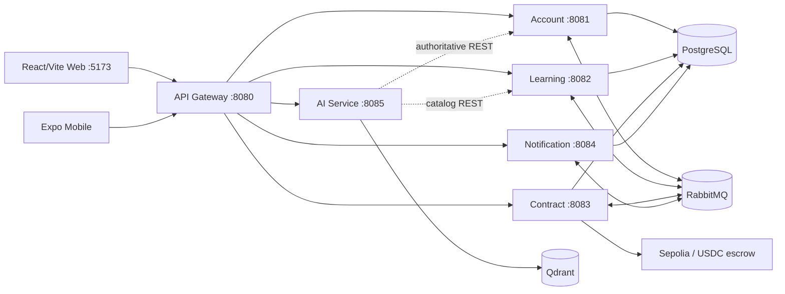
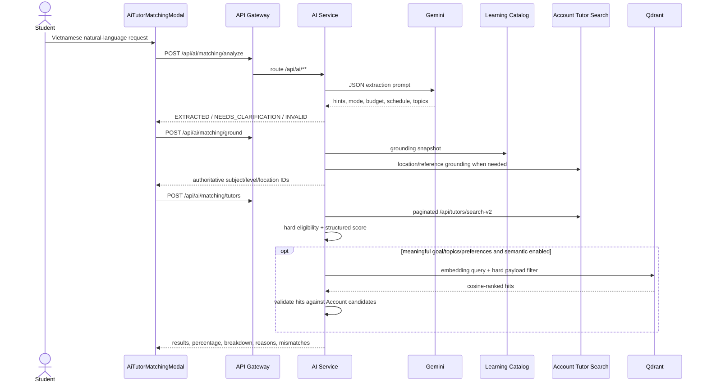

# Architecture, Services and Data Flow

## 1. Repository topology

| Area | Source evidence | Classification |
|---|---|---|
| Backend services | Maven aggregator modules in [`pom.xml`](../../pom.xml): API Gateway, Account, Learning, Contract, Notification, AI | `FACT/VERIFIED_SOURCE` |
| Web | React/Vite package in [`frontend-web/package.json`](../../frontend-web/package.json) | `FACT/VERIFIED_SOURCE` |
| Mobile | Expo package under [`mobile-app/`](../../mobile-app/) | `VERIFIED_SOURCE`; runtime not exercised |
| Persistence | PostgreSQL 16 compose service and Flyway migrations in [`docker-compose.yml`](../../docker-compose.yml), service resources | `VERIFIED_SOURCE`; runtime blocked |
| Messaging | RabbitMQ 3.13 compose service and service messaging packages | `VERIFIED_SOURCE`; runtime blocked |
| Vector search | Qdrant 1.18.3 compose service; AI Qdrant clients | `VERIFIED_SOURCE`; runtime blocked |
| Blockchain | Foundry project under [`blockchain/`](../../blockchain/) and Contract Service | `VERIFIED_SOURCE`; live chain not exercised |

## 2. Service architecture

Gateway route evidence is in [`application.properties`](../../backend/api-gateway/src/main/resources/application.properties):9-65. The repository documentation calls this Service-Based Architecture in [`docs/ARCHITECTURE.md`](../ARCHITECTURE.md):1-25.

## 3. Tutor AI flow

Frontend call order is evidenced by [`aiMatching.js`](../../frontend-web/src/api/aiMatching.js):3-15 and [`AiTutorMatchingModal.jsx`](../../frontend-web/src/components/matching/AiTutorMatchingModal.jsx):47-122. The gateway only routes `/api/ai/**`; it does not perform ranking.

## 4. Manual search versus AI search

| Dimension | Manual | AI |
|---|---|---|
| Entry | Account/Learning public search APIs, e.g. `/api/tutors/search-v2` | Web modal -> analyze -> ground -> match |
| Query | Explicit filters and sort/page | Natural language converted to structured request |
| Retrieval | Domain service search | Account candidate retrieval, then optional Qdrant semantic retrieval |
| Ranking | Service-side manual search behavior | AI Service deterministic weighted score plus bounded semantic rank boost |
| Explanation | Normal search response | `scoreBreakdown`, `matchingReasons`, `mismatchReasons`, `missingData` |
| Auth | Public/manual endpoints as configured | Analyze/ground/match require Student role in [`SecurityConfig.java`](../../backend/ai-service/src/main/java/iuh/fit/ai_service/config/SecurityConfig.java):63-72 |

## 5. Data ownership

AI does not own tutor or catalog truth. It consumes Account/Learning REST contracts through [`AccountTutorSearchClient.java`](../../backend/ai-service/src/main/java/iuh/fit/ai_service/client/AccountTutorSearchClient.java):23-58 and the semantic authoritative validation path in [`StudentSemanticSearchService.java`](../../backend/ai-service/src/main/java/iuh/fit/ai_service/service/semantic/StudentSemanticSearchService.java):44-151.

## 6. Chatbot/RAG and blockchain boundaries

The chatbot has a separate RAG flow: Markdown knowledge documents -> chunks -> Gemini embeddings -> Qdrant collection -> role visibility and minimum-score retrieval. Source evidence: [`ChatKnowledgeIndexService.java`](../../backend/ai-service/src/main/java/iuh/fit/ai_service/chatbot/rag/ChatKnowledgeIndexService.java):45-205 and [`ChatRagRetriever.java`](../../backend/ai-service/src/main/java/iuh/fit/ai_service/chatbot/rag/ChatRagRetriever.java):24-52. This is not the tutor ranker.

Blockchain is a Contract Service concern. Solidity/ABI and deployment files exist, but this audit did not submit transactions. The repository baseline states USDC is escrow and Sepolia ETH is gas in [`docs/BLOCKCHAIN.md`](../BLOCKCHAIN.md):1-25. Any live-chain claim remains `NOT_VERIFIED` here.

## 7. Runtime classification

- `VERIFIED_SOURCE`: files, routes, algorithms, tests and configuration inspected locally.
- `VERIFIED_RUNTIME`: only commands that completed locally (targeted tests and frontend build).
- `INFERRED`: sequence diagrams and cross-service flow reconstructed from inspected clients/configuration.
- `NOT_IMPLEMENTED`: no evidence of training, feedback labels, evaluation service or LTR model.
- `BLOCKED`: live API/database/Qdrant because Docker daemon timed out and no authenticated deployment endpoint was supplied.
